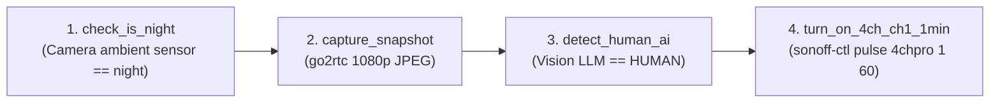

# PicoClaw on Balena (`balena-picoclaw`)

Turn a **Raspberry Pi Zero**, **Orange Pi Zero**, **BeagleBone Black**, or any low-spec single-board computer (`256MB–512MB RAM`) into a 24/7, self-healing **[PicoClaw](https://picoclaw.io/)** AI agent & smart-home edge automation appliance running on **balenaOS**.

Inspired by [`ClawQueue/openclaw-balena`](https://github.com/ClawQueue/openclaw-balena), this stack pairs PicoClaw's ultra-lightweight Go runtime (**<10 MiB RAM core**) with optional single-binary edge automation tools (**[Dagu](https://github.com/dagucloud/dagu)** for visual YAML workflows + **[go2rtc](https://github.com/AlexxIT/go2rtc)** for ONVIF/RTSP/Thingino cameras + **local Sonoff LAN control**)—all idling comfortably in **~14 MiB RAM** (base stack) or **~59 MiB RAM** (full camera + visual rule engine stack).

[](https://dashboard.balena-cloud.com/deploy?repoUrl=https://github.com/ClawQueue/balena-picoclaw)

---

## Key Highlights

- **Built for Constrained SBCs (`256MB–512MB RAM`, `ARMv6` / `ARMv7` / `ARM64`)**:
  - Automatically detects and installs official pre-compiled static binaries (`armv6`, `armv7`, `arm64`, `riscv64`, `x86_64`) with SHA256 verification.
  - Auto-tunes Go's garbage collector (`GOMEMLIMIT=64MiB` on 256MB boards, `128MiB` on 512MB boards, `GOGC=50`) and HAProxy (`maxconn 64`).
  - Tested live on an **Orange Pi Zero (`ARMv7`, 512MB RAM)**: `proxy` (`~5 MiB`) + `picoclaw` (`~8.5 MiB`) = **`13.5 MiB` total RAM**.
- **microSD & eMMC Flash Wear Protection**:
  - Volatile logs (`$PICOCLAW_HOME/logs`, Dagu & `go2rtc` logs), upgrade downloads, and backup staging are mounted in **RAM (`tmpfs`)** so they never wear out your microSD card or onboard eMMC.
  - SQLite databases are automatically tuned with `PRAGMA journal_mode=WAL` and `PRAGMA synchronous=NORMAL`.
  - Version snapshots in `/data/picoclaw/versions/<tag>/` are capped at `2` by default to fit easily on a BeagleBone Black's 4GB eMMC.
- **Full LAN & Hardware Peripheral Visibility**:
  - Runs with `network_mode: host` and `privileged: true` so your AI agent can discover and control LAN devices (mDNS, ONVIF/Thingino IP cameras, stock Sonoff eWeLink LAN switches, SSH hosts) and access hardware buses (`I2C`, `SPI`, `UART/Serial`, `GPIO`).
- **Clean Public/Private Separation (`gateway/secrets/`)**:
  - Keep your Git repository 100% vanilla and sanitized while storing personal model overrides, OAuth credentials, LAN device keys, and startup hooks in git-ignored files inside `gateway/secrets/`.

---

## Supported Hardware

| Board Family | Architecture | Balena Device Type | RAM | Measured Idle RAM |
| :--- | :--- | :--- | :--- | :--- |
| **Orange Pi Zero / One / Lite** | `ARMv7` (`armv7hf`) | `orange-pi-zero` / `orange-pi-one` / `orange-pi-lite` | 256MB–512MB | `~13.5 MiB` (`~59 MiB` with Dagu + `go2rtc`) |
| **Raspberry Pi Zero / Zero W / Pi 1** | `ARMv6` (`armhf`) | `raspberry-pi` | 512MB | `~14 MiB` |
| **BeagleBone Black / Green / Pocket** | `ARMv7` (`armv7hf`) | `beaglebone-black` / `beaglebone-green` / `beaglebone-pocket` | 512MB | `~14 MiB` |
| **Raspberry Pi Zero 2 W** | `ARMv7` / `ARM64` | `raspberrypi0-2w-64` / `raspberry-pi2` | 512MB | `~15 MiB` |
| **Raspberry Pi 2 / 3 / 4 / 5** | `ARMv7` / `ARM64` | `raspberry-pi2` / `raspberrypi3` / `raspberrypi4-64` / `raspberrypi5` | 1GB–16GB | `~15 MiB` |
| **Generic x86_64 / ARM64 Mini PCs** | `amd64` / `aarch64` | `generic-amd64` / `generic-aarch64` | Any | `~18 MiB` |

---

## Architecture Overview

```text
┌─────────────────────────────────────────────────────────────────────────┐
│                    balenaOS Host (network_mode: host)                   │
│                                                                         │
│  ┌──────────────────────────┐        ┌───────────────────────────────┐  │
│  │  proxy (HAProxy Alpine)  │        │  picoclaw (Gateway Container) │  │
│  │  ~5 MiB RAM              │        │  ~8.5 MiB RAM (Base)          │  │
│  │                          │        │                               │  │
│  │  • :80  (Balena Tunnel)  ├───────▶│  • picoclaw-launcher (:18800) │  │
│  │  • :443 / :8443 (HTTPS)  │        │  • picoclaw gateway  (:18790) │  │
│  └──────────────────────────┘        │  • rclone RAM backup daemon   │  │
│                                      │                               │  │
│                                      │  Optional Edge Addons:        │  │
│                                      │  • Dagu Visual Rules  (:8085) │  │
│                                      │  • go2rtc ONVIF/RTSP  (:1984) │  │
│                                      │  • sonoff-ctl (eWeLink LAN)   │  │
│                                      └───────────────────────────────┘  │
└─────────────────────────────────────────────────────────────────────────┘
```

1. **`proxy` (`haproxy:2.9-alpine`, `~5 MiB RAM`)**:
   - Generates a persistent 10-year self-signed TLS certificate and serves HTTPS on `:443` and `:8443`, plus HTTP on `:80` for Balena Cloud's Public Device URL tunnel.
   - Forwards `Host` and `X-Forwarded-*` headers required by PicoClaw's WebUI CSRF check and `/pico/ws` WebSocket origin verification.
   - Automatically fails over from `picoclaw-launcher` (`127.0.0.1:18800`) to headless `picoclaw gateway` (`127.0.0.1:18790`) when `PICOCLAW_MODE=gateway`.
2. **`picoclaw` (`alpine:3.21` + official `picoclaw` & `picoclaw-launcher` static binaries)**:
   - Manages isolated version snapshots in `/data/picoclaw/versions/<version>/` with automatic rollback on failed upgrades.
   - Seeds credentials (`dashboard.password` and `gateway.token`), runs first-boot onboarding, applies optional `gateway/secrets/` overrides, and runs the RAM-buffered `rclone` backup daemon.

---

## Quick Start Deployment

### Option A: One-Click Deploy to Balena Cloud
Click the **Deploy with balena** button at the top of this README, choose your board type (e.g., `Orange Pi Zero`, `Raspberry Pi (v1 / Zero / Zero W)`, or `BeagleBone Black`), flash your microSD card, and boot the board.

### Option B: Deploy via Balena CLI
```bash
git clone https://github.com/ClawQueue/balena-picoclaw.git
cd balena-picoclaw
balena login
balena push <your-fleet-name>
```

---

## Connecting to Your Appliance

### 1. Retrieve Credentials from Balena Logs
Once the device starts, check the `picoclaw` service logs in the Balena Cloud dashboard:

```text
==================================================================
  PicoClaw Balena Appliance
  Version        : v0.2.6 (armv7)
  Runtime Mode   : launcher (GOMEMLIMIT=128MiB, GOGC=50)
  Home Directory : /data/picoclaw/versions/v0.2.6/picoclaw-home
------------------------------------------------------------------
  WebUI Password : <24-char-password>
  Pico WS Token  : <64-char-hex-token>
  Public URL     : https://<uuid>.balena-devices.com
  Local LAN URL  : https://<device-ip> (or :8443 / http://<device-ip>:18800)
==================================================================
```

### 2. Sign In to the WebUI Console
- **Via Local LAN**: Open `http://<device-ip>:18800` or `https://<device-ip>:8443`.
- **Via Balena Public Device URL**: Enable **Public Device URL** in Balena Cloud and open `https://<uuid>.balena-devices.com`.
- Enter the **WebUI Password** from the logs to configure models, OAuth providers, and chat channels.

---

## Isolating Personal Customizations (`gateway/secrets/`)

To keep your repository clean and safe to publish while deploying personal models, OAuth tokens, LAN permissions, or automation scripts to your own devices, copy any `.example` file inside `gateway/secrets/` (removing the `.example` suffix).

- **Git ignores `gateway/secrets/*`** (except `.keep` and `*.example`), so your secrets are **never committed to Git**.
- **`.dockerignore` allows `gateway/secrets/`**, so `balena push` bundles your local overrides into `/app/secrets/` inside your private device image. You can also place files directly in `/data/picoclaw/secrets/` on the device's persistent volume.

| Secret File | Example Template | Purpose |
| :--- | :--- | :--- |
| `gateway/secrets/config.override.json` | [config.override.json.example](file:///Users/manolis/Documents/balena-picoclaw/gateway/secrets/config.override.json.example) | Deep-merged (`jq -s '.[0] * .[1]'`) onto `config.json` on every boot (custom models, LAN `private_host_whitelist`, `enable_deny_patterns: false`, MCP servers). |
| `gateway/secrets/secrets.env` | [secrets.env.example](file:///Users/manolis/Documents/balena-picoclaw/gateway/secrets/secrets.env.example) | Sourced by `start.sh` on startup (e.g., `PICOCLAW_EXTRA_PKGS="openssh-client iputils nmap"`). |
| `gateway/secrets/auth.json` | *(copied from `$PICOCLAW_HOME/auth.json`)* | Pre-seeds OAuth tokens (e.g., OpenAI Codex OAuth) across fresh SD card flashes. |
| `gateway/secrets/init.sh` | [init.sh.example](file:///Users/manolis/Documents/balena-picoclaw/gateway/secrets/init.sh.example) | Custom startup hook executed before PicoClaw launches (starts `dagu`, `go2rtc`, installs helper CLIs). |
| `gateway/secrets/sonoff-ctl` | [sonoff-ctl.example](file:///Users/manolis/Documents/balena-picoclaw/gateway/secrets/sonoff-ctl.example) | Zero-dependency local LAN controller (`:8081` AES-128-CBC) & eWeLink Cloud key fetcher for stock Sonoff switches (including **Sonoff 4CH Pro**). |
| `gateway/secrets/vision-human-check` | [vision-human-check.example](file:///Users/manolis/Documents/balena-picoclaw/gateway/secrets/vision-human-check.example) | Sends a camera JPEG snapshot to your vision LLM and exits `0` (`HUMAN`) or `1` (`NONE`). |

---

## Lightweight Visual Rules for Cameras & Sonoff Devices (`Dagu` + `go2rtc` + `sonoff-ctl`)

Instead of running heavy Node-RED (`>120 MiB RAM`) or Home Assistant (`>600 MiB RAM`), this repository includes ready-to-use templates in `gateway/secrets/*.example` that pair three tiny tools inside the same container:

1. **[`go2rtc`](https://github.com/AlexxIT/go2rtc) (`:1984`, `~8–20 MiB RAM`)**:
   - Connects to **ONVIF**, **RTSP**, and **[Thingino](https://thingino.com/)** IP cameras.
   - Provides a live browser stream viewer at `http://<device-ip>:1984` and an instant HTTP JPEG frame API (`http://127.0.0.1:1984/api/frame.jpeg?src=...`).
2. **[`dagu`](https://github.com/dagucloud/dagu) (`:8085`, `~30–40 MiB RAM`)**:
   - A single-binary Go workflow engine with a **Visual DAG WebUI** (`http://<device-ip>:8085`) and a built-in **MCP server** (`http://127.0.0.1:8085/mcp`).
   - Rules are plain `.yaml` files in `/data/dagu/dags/*.yaml`—making it effortless for **PicoClaw** to read, write, and trigger rules programmatically while giving you a visual graph, live green/red step statuses, and execution logs to confirm.
3. **`sonoff-ctl` (`0 MiB` idle RAM, pure `bash` + `openssl` + `jq` + `curl`)**:
   - Controls stock eWeLink firmware devices (single plugs and multi-channel **Sonoff 4CH Pro** strips) directly over your local LAN (`http://<sonoff-ip>:8081/zeroconf/switches`) using eWeLink LAN v3 AES-128-CBC encryption.
   - Includes a one-time `fetch-keys` helper that logs into your eWeLink account, extracts the local `devicekey` for every Sonoff device, and saves them to `/data/picoclaw/secrets/sonoff-devices.json`:
     ```bash
     # Pull all device IDs and local LAN keys from your eWeLink account once:
     sonoff-ctl fetch-keys "you@example.com" "your-ewelink-password" eu

     # Control Sonoff 4CH Pro channels (1–4) locally over LAN in <20ms:
     sonoff-ctl switch 4chpro 1 on
     sonoff-ctl switch 4chpro 1 off
     sonoff-ctl pulse  4chpro 1 60   # Turn ON Channel 1 for 60s, then OFF
     ```

### Example Rule: *Camera Detects Human at Night ➔ Turn ON Sonoff 4CH Pro Ch1 for 1 Min*

Included in [init.sh.example](file:///Users/manolis/Documents/balena-picoclaw/gateway/secrets/init.sh.example) (`/data/dagu/dags/night_human_motion_light.yaml`):



- **Zero-Polling Camera Trigger**: On a Thingino camera (`cam_185`), hardware IVS motion detection calls `POST http://<picoclaw-ip>:8085/api/v1/dags/night_human_motion_light/start` immediately when motion starts.
- **Visual Confirmation & Daytime Testing**: Open `http://<picoclaw-ip>:8085/dags/night_human_motion_light` to inspect the 4-step graph, view per-step logs, or trigger a test run with `FORCE_NIGHT=true`.

---

## Environment Variables Reference

Configure these as **Fleet Variables** or **Device Variables** in Balena Cloud:

| Variable | Default | Description |
| :--- | :--- | :--- |
| `PICOCLAW_MODE` | `launcher` | `launcher` runs WebUI Console + Gateway (`~8.5 MiB RAM`). Set to `gateway` for headless mode (`<6 MiB RAM`). |
| `PICOCLAW_VERSION` | `image` | PicoClaw release to run (`image` uses pre-baked binary, `latest` fetches latest GitHub release, or pin e.g. `v0.2.6`). |
| `PICOCLAW_KEEP_VERSIONS` | `2` | Number of version snapshots retained in `/data/picoclaw/versions/` for instant rollback. |
| `PICOCLAW_DASHBOARD_PASSWORD` | *(auto-generated)* | Custom password for the PicoClaw WebUI Console. Persisted in `/data/picoclaw/dashboard.password`. |
| `PICOCLAW_GATEWAY_TOKEN` | *(auto-generated)* | Custom token for the Pico WebSocket channel (`/pico/ws`). Persisted in `/data/picoclaw/gateway.token`. |
| `PICOCLAW_ENABLE_HARDWARE` | `false` | Set to `true` to enable `i2c`, `spi`, `serial`, and `devices` tools in `config.json`. |
| `PICOCLAW_DEFAULT_MODEL` | *(from config)* | Override default model alias (`agents.defaults.model_name`). |
| `PICOCLAW_EXTRA_PKGS` | *(optional)* | Space-separated Alpine packages to install at container startup (e.g. `openssh-client iputils nmap`). |
| `PICOCLAW_GOMEMLIMIT` | *(auto: `64MiB`/`128MiB`)* | Soft memory limit for the Go runtime garbage collector. |
| `PICOCLAW_GOGC` | `50` | Go GC percentage (`50` triggers GC earlier than default `100` to keep RSS low). |
| `PICOCLAW_GATEWAY_STOP` | `false` | Set to `true` to pause the container entrypoint (`sleep infinity`) for maintenance via `balena ssh`. |
| `RCLONE_REMOTE` | `gdrive:picoclaw-backups` | Target `rclone` remote path for automated RAM-buffered cloud backups. |
| `BACKUP_INTERVAL` | `86400` | Seconds between automated backups (`86400` = 24 hours). |
| `BACKUP_RETENTION_DAYS` | `30d` | Minimum age of remote backup archives before automatic pruning. |

---

## Troubleshooting Low-Spec SBCs on balenaOS

1. **Orange Pi Zero (`xradio_wlan`) 4 Red LED Blinks on First Boot**:
   - On `balenaOS 2.53.9`, the Allwinner `xradio_wlan` driver can take 5 attempts to complete a WPA2 handshake while NetworkManager defaults to 4 retries.
   - Fix: In your `/mnt/boot/system-connections/balena-wifi-01` profile, add `autoconnect-retries=0` under `[connection]` and `powersave=2` under `[802-11-wireless]`.
2. **Balena Cloud "Reduced Functionality" (Tunnel works, Dashboard shows Offline)**:
   - On older `balenaOS 2.x` releases where IPv6 is unrouted on the local network, OpenVPN may loop on `AAAA` records for `cloudlink.balena-cloud.com`.
   - Fix: Set `proto tcp4` in `/etc/openvpn/openvpn.conf` on the host OS and run `systemctl restart openvpn`.

---

## License

MIT License — see [PicoClaw](https://github.com/sipeed/picoclaw) and [openclaw-balena](https://github.com/ClawQueue/openclaw-balena).
